## Tube Service

Welcome to Tube Service iOS app!  This is a SwiftUI app and is available on [the app store](https://apps.apple.com/app/id1540626286#?platform=iphone).

## Screenshots

<p>
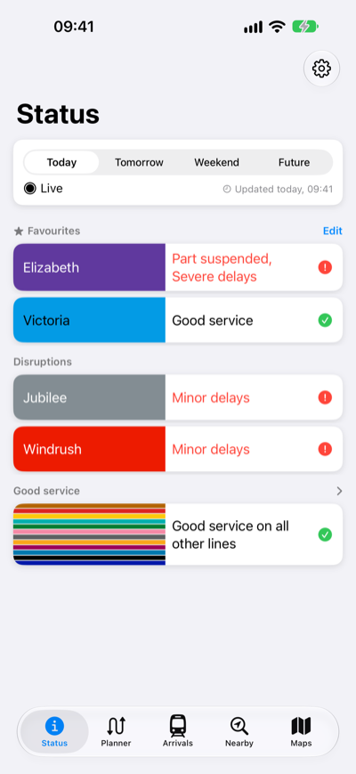
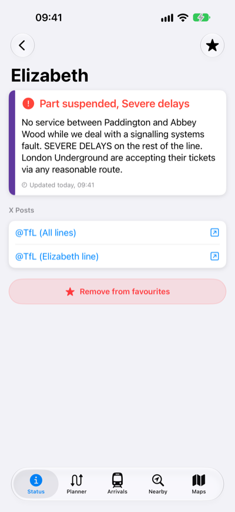
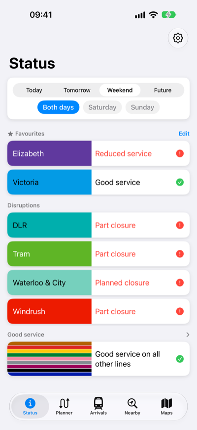
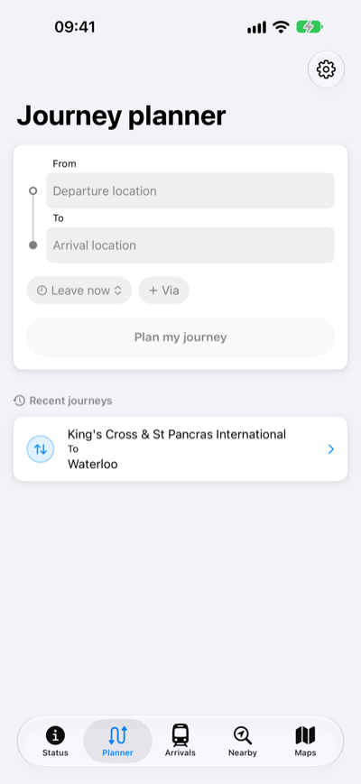
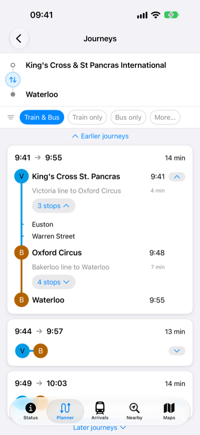
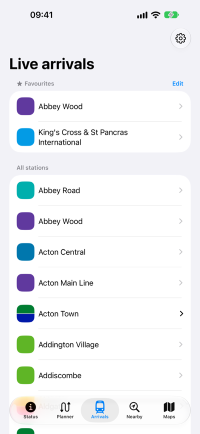
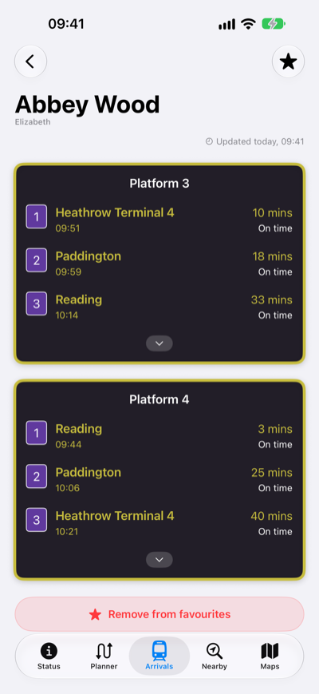
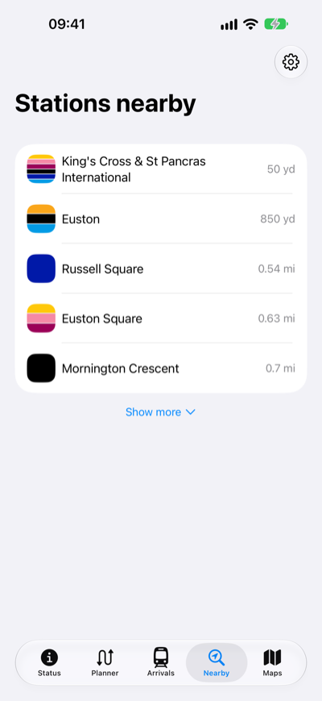
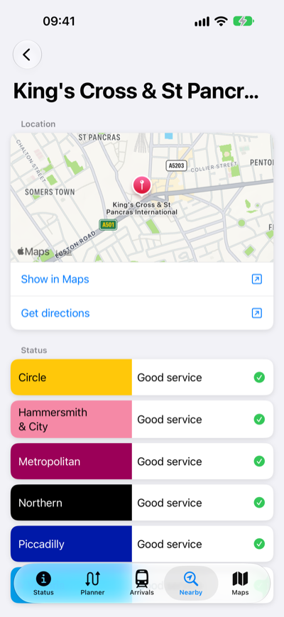
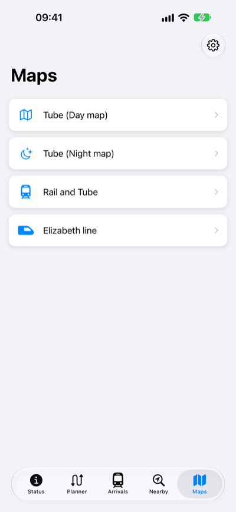
</p>

## Getting Started

1. Install the Xcode version in [`.xcode-version`](.xcode-version).
1. Open `Tube.xcodeproj`, select an iOS simulator and tap "Run".

Debug builds run without the `TFL_API_APP_KEY` and `TUBE_SERVICE_API_KEY` keys (see [`Debug.xcconfig`](Config/Debug.xcconfig)). There's no Tube Service API dev server yet, so features that use it need the API running locally on `localhost:8000`.

To run fastlane locally, install the Ruby version in [`.ruby-version`](.ruby-version), then:

```sh
bundle install
bundle exec fastlane unit_tests
```

The test and screenshot lanes need no secrets (see [`Scripts/screenshots.sh`](Scripts/screenshots.sh)). The signing and App Store Connect lanes run on CI, which holds the keys.

## Architecture

The app uses the [MV architecture](https://azamsharp.com/2023/02/28/building-large-scale-apps-swiftui.html) but I have previously used both MVVM and the [Swift Composable Architecture](https://github.com/pointfreeco/swift-composable-architecture).

> The original app's source code (developed using The Composable Architecture) is available [here](https://github.com/ridgeview-apps/tube-service/tree/legacy/tca).

Swift Package Manager is used to modularize the app as follows:

* `Models` - the main objects / models used globally across the app (e.g. `Station`, `LineStatus` etc)
* `DataStores` - the main data / business logic for the app
* `PresentationViews` - plain ("dumb") views / reusable components. These are purely for presentation purposes (hence perfect for SwiftUI previews). The components are typically just parts of a screen and contain no business logic.
* `Shared` - shared logic that can be used by ANY part of the app (i.e. any package or target - for example, `String`, `Date` extensions etc)

Each arrow points from a package to the packages and targets that use it:

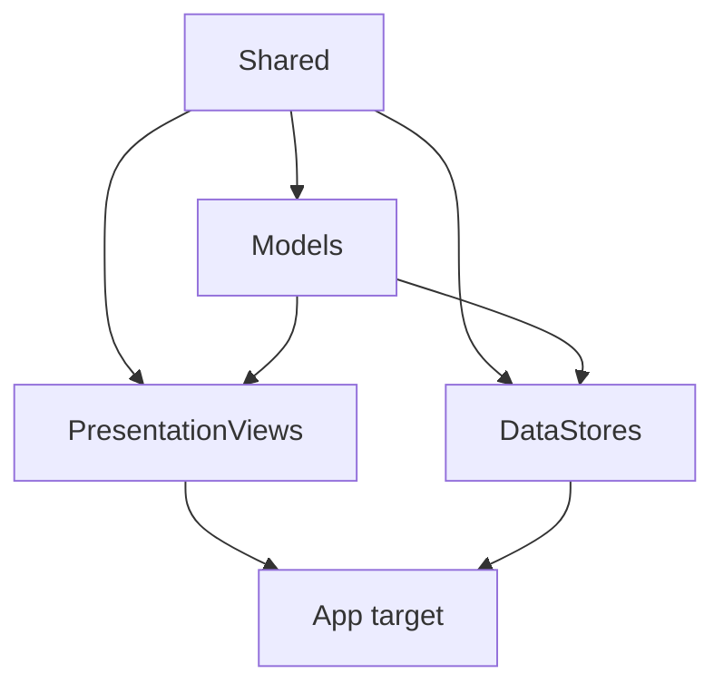

The main point to note is that the `PresentationViews` and `DataStores` packages are completely isolated from one another. The main app target itself is predominantly just composed of "screens" (which do all the heavy lifting and wire everything together - see example below).

> There are many ways to modularize an app, and I strongly recommend splitting up larger apps further into [bounded contexts](https://azamsharp.com/2023/02/28/building-large-scale-apps-swiftui.html#multiple-aggregate-modelsstores). The above structure, however, is a pretty good starting point and the packages themselves can be further subdivided as the app grows.

### Line Status feature example

Line statuses are a good example of data used in multiple parts of the app. The feature is set up as follows:

* The data objects (e.g. `Line`, `LineStatus`) are defined in the `Models` package.
* The `PresentationViews` package uses these models to build reusable / previewable components
* The `LineStatusDataStore` (in the `DataStores` package) is responsible for loading and storing line status data (as an `Observable` / `Environment` object) which can then be used globally across the app). The `Observable` resides here rather than in the the main app target as this makes it more reusable across other targets (for example, widget extensions, watch etc).
* In the main app target, `LineStatusDataStore` is used in a couple of places (`LineStatusScreen` and `StationScreen`). These are completely separate screens and assembled with different presentation views but both share the same `LineStatusDataStore` object as their source of truth (hence any updates on one screen will automatically reflect on the other).

> Note: The `PresentationViews` package used to be a completely standalone package with its own separate models. However I found myself frequently transforming from a `Models` "model" -> `PresentationViews` "model". So I found it much simpler to cut out the middle man and gave `PresentationViews` direct access to the `Models` package (any "presentation"-specific properties could simply be added via Swift extensions). This also makes data stubbing much simpler (for example `ModelStubs` contains lots of pre-configured data models which are perfect for SwiftUI previews and unit testing).

## Tests

### Unit tests

Unit tests are written for the key parts of the app (model layer, data stores, presentation views) and each Swift package's unit tests can either be run in isolation or all at once with the main app target.

> Note: when using other approaches such as MVVM, pretty much all my tests were for view models. However, on SwiftUI, this always felt unnatural to me (i.e. view models served a great purpose in UIKit, RxSwift-world, but less so on SwiftUI). I took a closer look at what I was actually testing in the view models and found much of it was unnecessary (and the bits that *were* important could be easily extracted out & unit tested separately).

### UI tests

UI tests (`TubeServiceUITests`) drive the app through page objects, and launch it with a `UITestLaunchConfiguration` that fixes the clock, saved state and stubbed API responses, so every run sees the same app. The App Store screenshots come from the same target (`ScreenshotTests`). See [AGENTS.md](AGENTS.md#ui-tests-tubeserviceuitests) for how they're structured, and run them with `bundle exec fastlane ui_tests`.

## Config

My preferred approach to config is to use `.xcconfig` files since they make it easier to handle merge conflicts (vs trying to resolve conflicts in a `.pbxproj` file).

The app's config files are set up as follows:

1. Base (see [`Base.xcconfig`](Config/Base.xcconfig)). This holds the app version and the values every build shares, and the others include it.
1. Debug (see [`Debug.xcconfig`](Config/Debug.xcconfig)). This is used for previews, tests and debugging the app on the simulator or a device and uses AUTOMATIC code-signing.
1. Release (see [`Release.xcconfig`](Config/Release.xcconfig)). This is used for CI / App Store builds and uses MANUAL code-signing (see [Fastlane](#fastlane) below).
1. CI builds add an environment on top of Release: [`CI/Beta.xcconfig`](Config/CI/Beta.xcconfig) for TestFlight betas (with their own bundle ID) or [`CI/Prod.xcconfig`](Config/CI/Prod.xcconfig) for the App Store. The workflow picks one with `XCODE_CONFIG`.

Note that the xcconfig files themselves contain two "kinds" of config:

1. Build & Archive settings (e.g. code signing settings, compilation settings, bundle ID)
1. App config properties (e.g. API URLs)

The app config properties are exposed in the `Info.plist` file and are loaded / referenced from Swift code (see [`AppConfig`](TubeService/App/Core/AppConfig.swift)). The API keys are left blank in the xcconfigs, and CI supplies them for Beta and App Store builds.


## Fastlane

* [`Fastlane`](https://fastlane.tools) is used to build and distribute the app.
* [`Fastlane match`](https://docs.fastlane.tools/actions/match/) is used to handle provisioning of CI builds. Although Apple has greatly improved its tools in recent years (e.g. automatic provisioning), I still find `match` to be a more mature and reliable solution, particularly in CI environments. For example, Apple's automatic provisioning still relies on having a user signed into Xcode via the Preferences pane, which can be flaky in a CI environment.
* Since [`Fastlane` now uses the App Store Connect API for most of its actions](https://docs.fastlane.tools/app-store-connect-api/), I have found it to be MUCH faster and easier to use (i.e. no longer need to worry about username/password credentials and all the headaches of 2-factor authentication in a CI environment).
* [`Fastlane snapshot`](https://docs.fastlane.tools/actions/snapshot/) is used to generate / upload screenshots to App Store Connect

The lanes are listed in [`fastlane/README.md`](fastlane/README.md), which fastlane generates from the [`Fastfile`](fastlane/Fastfile).


## CI and releases

GitHub Actions workflows build, test and release the app. Their comments explain the details.

* [Branch checks](.github/workflows/branch-checks.yml) lints and runs the unit tests on every push to a `feature/**` or `hotfix/**` branch.
* [Beta](.github/workflows/beta.yml) lints, tests and builds every push to `main` with the Beta config, and uploads it to [TestFlight](https://developer.apple.com/testflight/).
* [Screenshots](.github/workflows/screenshots.yml) generates the App Store screenshots when run by hand, and can upload them once approved.
* [Check Secret](.github/workflows/check-secret.yml) prints a fingerprint of a repository secret, to compare with a local value from [`Scripts/fingerprint-secret.sh`](Scripts/fingerprint-secret.sh).

To release a version:

1. Run [Start release](.github/workflows/start-release.yml) on `main`. It's a dry run unless you untick it. It creates `release/<version>` for the version in `Base.xcconfig`, bumps `main` to the next version, and starts the App Store workflow on the release branch and Beta on `main`.
1. The [App Store](.github/workflows/app-store.yml) workflow's **Build and upload** job builds with the Prod config, uploads to TestFlight and syncs the App Store metadata.
1. Approve **Submit for review** to send the build to App Review. It also tags the commit with the version and creates the GitHub release.
1. Once Apple approves the version, approve **Publish** to release it on the App Store. It also deletes the release branch.
